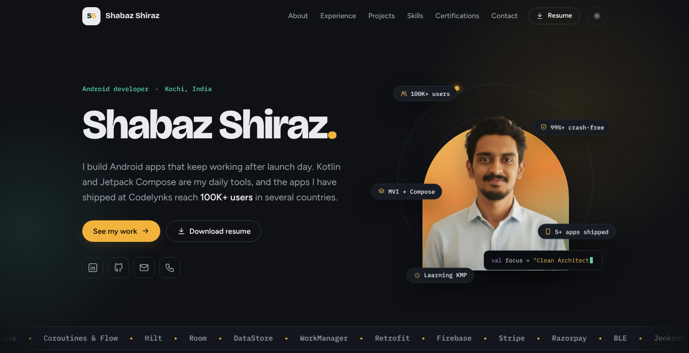

# Shabaz Shiraz | Portfolio

Personal portfolio of **Shabaz Shiraz**, an Android developer in Kochi, India. I work with Kotlin, Jetpack Compose and MVI, and the apps I have shipped at Codelynks Software Solutions reach 100K+ users.

**Live site:** [shabaz-shiraz.github.io](https://shabaz-shiraz.github.io)


<picture>
  <source media="(prefers-color-scheme: light)" srcset="docs/preview-light.png">
  
</picture>

## Stack

- **HTML5**: one semantic page, with Open Graph tags and JSON-LD `Person` data for search engines.
- **CSS3**: custom properties for the light and dark themes, plus Grid, Flexbox and keyframe animations.
- **Vanilla JavaScript**: IntersectionObserver and requestAnimationFrame. No frameworks and no build step.
- **Fonts**: Bricolage Grotesque, Figtree and IBM Plex Mono, loaded from Google Fonts.
- **Hosting**: GitHub Pages, deployed from the `main` branch.

## Sections

| Section | What it shows |
| --- | --- |
| Hero | Name, role, short intro, resume download, social links and portrait |
| Stats | Years of experience, apps shipped, users reached and crash-free rate |
| About | How I approach Android work, with four focus areas |
| Experience | Timeline of my work at Codelynks and my B.Tech |
| Projects | V-Guard Smart 2.0 (featured), Swoozle, Munsit, V-Guard Tez and Last Seat Out |
| Skills | Core stack, grouped skills, ways of working and what I am learning |
| Certifications | Kotlin Multiplatform, Google Cybersecurity and Google Project Management |
| Contact | Email, phone, LinkedIn, GitHub, location and the locations I am open to |

## Features

- **Responsive layout**, from 320px phones to wide desktops, with a mobile menu.
- **Light and dark themes**: follows the system setting, remembers the visitor's choice and cross-fades between themes.
- **Motion**:
  - staggered hero entrance, drifting background glows, rotating orbits and floating chips
  - a code line that types itself
  - a scrolling tech strip that pauses on hover
  - sections that reveal as you scroll, with staggered cards
  - stats that count up once they are on screen
  - a timeline line that fills as you scroll
  - a cursor spotlight on project cards
  - a scroll progress bar and a back-to-top button
- **Accessibility**: skip link, keyboard focus styles, alt text and ARIA labels. All motion is turned off for visitors who prefer reduced motion.
- **SEO**: meta description, Open Graph tags, canonical URL, JSON-LD, `robots.txt`, `sitemap.xml` and a custom `404.html`.

## Structure

```
.
├── index.html              # the whole site
├── 404.html                # page for unknown addresses
├── site.webmanifest        # app name, colours and icon
├── robots.txt
├── sitemap.xml
├── .nojekyll               # serve files as they are, without Jekyll
├── assets/
│   ├── css/style.css       # theme tokens, layout, components, animations
│   ├── js/main.js          # scroll effects, count-up, typing, menu, theme
│   ├── img/                # portrait and favicon
│   └── resume/             # Shabaz_Shiraz_Android_Developer.pdf
└── docs/                   # screenshots used in this README
```

## Run locally

No install needed. Clone the repo and open `index.html`, or start a local server:

```bash
git clone https://github.com/Shabaz-Shiraz/Shabaz-Shiraz.github.io.git
cd Shabaz-Shiraz.github.io
python3 -m http.server 8000
```

Then visit http://localhost:8000.

## Common edits

| To change | Edit |
| --- | --- |
| Any text | `index.html`. Each section starts with a comment such as `<!-- Projects -->` |
| Resume | Replace `assets/resume/Shabaz_Shiraz_Android_Developer.pdf`, keeping the file name |
| Photo | Replace `assets/img/portrait.webp` and `assets/img/portrait.png` |
| Play Store links | Search `index.html` for `PLAY STORE` and paste each app's URL |
| Colours | The `:root` and `[data-theme="dark"]` blocks at the top of `assets/css/style.css` |
| Typing card lines | The `data-typing` attribute in the hero, with values separated by `\|` |

## Deploy

The site is served by GitHub Pages from the root of the `main` branch. Every push to `main` goes live at https://shabaz-shiraz.github.io within a minute or two. You can follow each deploy under the repo's **Actions** tab.

## Contact

- Email: [s4shabazshiraz@gmail.com](mailto:s4shabazshiraz@gmail.com)
- LinkedIn: [linkedin.com/in/shabaz-shiraz](https://www.linkedin.com/in/shabaz-shiraz/)
- Phone: +91 95448 38456

---

© 2026 Shabaz Shiraz. All rights reserved.
